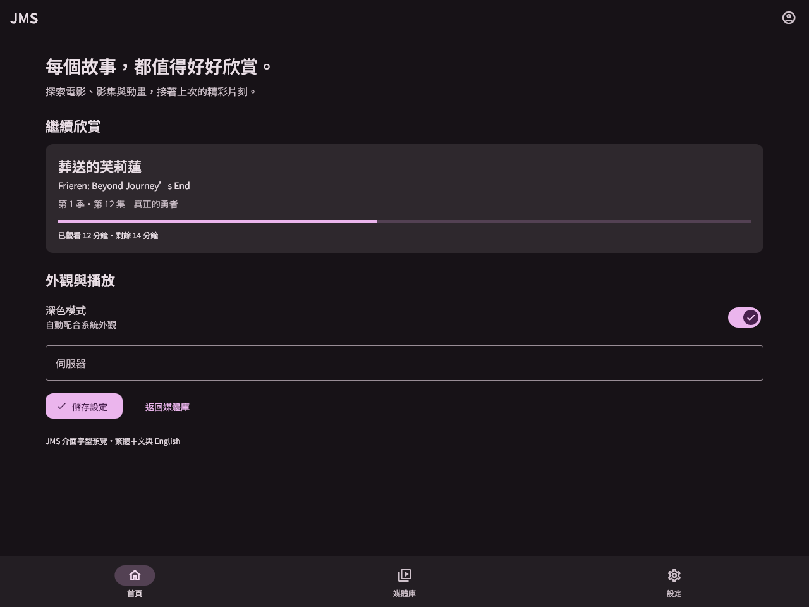
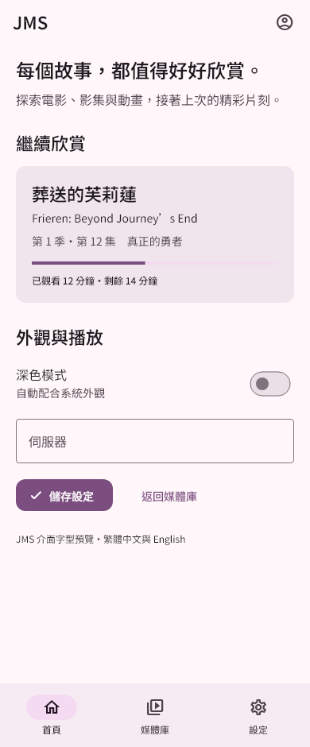
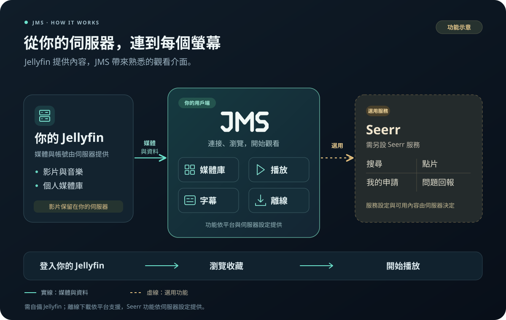

# JMS — Jim608 Media Server

**把自己的 Jellyfin 媒體庫，帶到手機與電腦。**

JMS 是基於 [Fladder](https://github.com/DonutWare/Fladder) 的跨平台 Jellyfin 用戶端，讓你瀏覽電影、影集與動畫，接著上次的進度播放，並在同一個介面處理字幕、離線下載與 Seerr 點片。繁體中文介面內建 Noto Sans TC 四種字重，支援深淺色與系統文字縮放。

使用前需要自己的 Jellyfin 伺服器或管理者提供的帳號。JMS 不提供影片來源；點片與問題回報需另有 Jellyseerr／Seerr 服務及對應權限。

## 下載 JMS

目前公開測試版為 **`0.11.1-jms.44+46`（Prerelease）**。請從對應平台的版本頁選擇附件，並核對同版 SHA256 校驗清單。

| 裝置 | 下載入口 | 提供內容 |
|---|---|---|
| Android ARM64 | [Android 版本頁](https://github.com/jim608/JMS-Android/releases/tag/v0.11.1-jms.44) | 完整 APK；套件識別碼 `com.jim608.jms` |
| Windows x64 | [Windows 版本頁](https://github.com/jim608/JMS-Desktop/releases/tag/v0.11.1-jms.44) | Setup 安裝程式、Portable ZIP |
| EndeavourOS／Arch x86_64 | [Linux 版本頁](https://github.com/jim608/JMS-Linux/releases/tag/v0.11.1-jms.44) | pacman 套件、可攜式壓縮包、本機 yay／makepkg 配方 |

Linux 本版沒有 Flatpak；本機配方尚未刊登 AUR，不能使用 `yay -S jms-bin`。Web 由管理者部署，本專案不提供公開媒體站台。各平台的安裝方式與限制見[桌面版指南](docs/JMS_DESKTOP.md)及對應版本說明。

Android 沿用測試簽章；Windows／Linux 尚未提供正式發行者簽章。Prerelease 不代表本人裝置、覆蓋安裝與所有播放情境皆已驗收。

## 可以用 JMS 做什麼？

| 功能 | 使用方式 |
|---|---|
| 媒體庫與播放 | 瀏覽、搜尋、切換帳號、查看詳情及播放影片，選擇音軌與字幕。 |
| 字幕時間微調 | 播放中輸入正負秒數或拖曳滑軌，範圍 ±60 秒、精度 0.01 秒，支援歸零。 |
| 下載與離線播放 | 將服務允許下載的媒體存到裝置，在離線時觀看；實際能力依平台與服務設定而定。 |
| Seerr 點片與回報 | 搜尋作品、查看「我的紀錄」與申請狀態，從詳情頁或播放選單回報影片問題。 |
| 播放環境光 | 調整光效強度、擴散與取樣間隔，依裝置效能選擇畫面同步方式。 |
| 日常觀看設定 | 深淺色、系統字體縮放、睡眠計時與非敏感設定備份。 |

Windows／Linux 的 MPV 支援兩條文字字幕獨立微調；Android／Web 支援主字幕，Android TV／手動 Native 暫不支援時間偏移。ASS／SSA 特效及圖片字幕保留播放器適用的原生模式。

桌面版另提供可選的 Discord 播放資訊分享，預設關閉；作品封面整合仍在驗證。分享內容需分別同意，Discord 不是使用 JMS 的必要條件。

## 看看新的繁體中文排版

以下是用 **JMS 真實主題與內建字型產生的合成介面預覽**，用來展示字重、排版與深淺色；不是完整 App 首頁或本人媒體庫截圖。片名及觀看進度均為示例。

<table>
  <tr><th>桌面・深色字型預覽</th><th>手機・淺色字型預覽</th></tr>
  <tr>
    <td width="70%"></td>
    <td width="30%"></td>
  </tr>
</table>

繁體中文採用內建 **Noto Sans TC 400／500／600／700** 真實靜態字重；一般畫面與媒體取色主題共用文字層級，英文介面保留 Open Sans。字型隨 App 提供，不需另外下載。[圖片來源與標示](docs/images/README.md)

## JMS、Jellyfin 與 Seerr 如何搭配？

1. **安裝並連接 Jellyfin**：輸入自己的伺服器網址，或管理者提供的網站入口，再用自己的帳號登入。
2. **選片與觀看**：瀏覽媒體庫、搜尋作品並播放；依需要調整音軌、字幕、環境光或下載。
3. **需要時再連接 Seerr**：設定自己的 Jellyseerr／Seerr 服務，確認來源與本人帳號相符，再使用點片、申請紀錄及回報。

JMS 不內建私人點片網址，也不使用共用管理員 API 密鑰替使用者點片。Seerr 登入、申請、留言與回報是否可用，取決於服務版本及帳號權限。

## 安裝後如何更新？

在「設定 → 關於」檢查所屬平台的新版本；要接收 Prerelease，先開啟「接收測試版」。檢查更新不等於自動下載或安裝，安裝仍由使用者確認，不會靜默安裝或主動清除既有 App 資料。

Android、Windows、Linux 各自使用獨立發布庫與更新資訊，不互相作為更新備援。Android 可與原版 Fladder 並存，但不會自動繼承原版登入資料。Linux 安全保存 Seerr 工作階段需可解鎖的 Secret Service 金鑰圈。

各版變更與已知問題見[版本紀錄](CHANGELOG.md)。手機實際安裝與播放、Windows 本人覆蓋安裝、Linux 實體桌面／GPU／音效的驗收範圍，請以各版公開說明為準。

## 原始碼與授權

三平台共用本倉庫 `jms` 分支的一份 Flutter 原始碼，Windows／Linux 發布庫不另存一份 App。各版附件另提供對應 `sourceCommit` 的完整來源及原生依賴材料。

使用 Flutter **3.35.7**、Dart **3.9.2**、JDK **21**、Android API **37** 及鎖定依賴；建置步驟見 [DEVELOPEMENT.md](DEVELOPEMENT.md) 與 [INSTALL.md](INSTALL.md)，原生來源及授權材料見 [JMS_SOURCES.md](docs/JMS_SOURCES.md)。

JMS 源自 DonutWare 與貢獻者的 Fladder，保留原作者署名、[GPLv3 授權](LICENSE)及第三方授權。Noto Sans TC 依 SIL Open Font License 提供。上游連結供來源署名，不是 JMS 更新來源。
